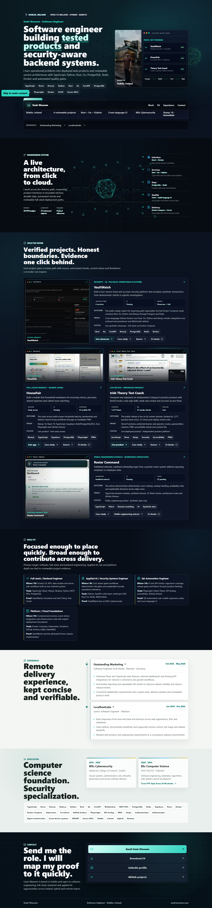

# Uzair Waseem - Engineering Portfolio

[](https://github.com/Assembler-Fourier/uzair-waseem-portfolio/actions/workflows/ci.yml)
[](https://uzairwaseem.com)

Recruiter-focused portfolio for **Uzair Waseem**, a Dublin-based software engineer working across tested web products, polyglot backend systems, applied AI workflows and security-aware delivery.



## Reviewer Path

1. Open the [live portfolio](https://uzairwaseem.com) for the concise hiring overview.
2. Start with [VaultWatch](https://github.com/Assembler-Fourier/vaultwatch), the primary polyglot security and applied-AI system.
3. Review [HouseFair](https://github.com/Assembler-Fourier/housefair-ai) for end-to-end product, data-isolation and mobile PWA evidence.
4. Inspect the live [Irish Theory Test Coach](https://irishtheorycoach.ie) product and its public engineering evidence.
5. Review the [Roster Command public engineering extract](https://github.com/Assembler-Fourier/employee-roster-command), which contains selected sanitised domain logic and synthetic fixtures rather than the private application.
6. Use [Doctor System](https://github.com/Assembler-Fourier/doctor-system) as supporting platform evidence; its README preserves upstream Apache-2.0 attribution and distinguishes validated infrastructure from live cloud deployment.
7. Try [DataProof](https://dataproof-quality-workbench.vercel.app), [ContractLens](https://contractlens-api-lab.vercel.app) and [DocuMind](https://documind-rag-assistant.vercel.app) for data-quality, API-contract and document-processing evidence.
8. Download the [one-page software engineering CV](https://uzairwaseem.com/Uzair-Waseem-CV.pdf).

## Public Project Status

| Project | Public boundary | Review path |
| --- | --- | --- |
| VaultWatch | Live synthetic showcase; full polyglot stack runs through Docker Compose | Rust, Go, Python/FastAPI, Next.js, PostgreSQL, Redis and cross-language CI |
| HouseFair | Live free early-access product | App, source, mobile Playwright checks |
| Irish Theory Test Coach | Live deployed EdTech platform | Custom domain, 1,277 practice items, protected routes and 15 post-deploy smoke checks |
| Roster Command | Public engineering extract; operational application remains private | Sanitised product capture, selected logic, synthetic fixtures, 23 tests and CI |
| DataProof | Live stateless CSV data-quality workbench | Profiles, reusable contracts, row-level diagnostics, CLI and CI |
| ContractLens | Live OpenAPI 3.0 contract lab | Response validation, compatibility analysis and executable test exports |
| DocuMind | Live document workspace; OpenAI requires a visitor key | PDF/DOCX ingestion, BM25 retrieval, citations and provider integration tests |

## What This Repository Demonstrates

- Next.js App Router implementation with semantic HTML and keyboard-visible focus states.
- Evidence-led case studies that distinguish live products, previews, demos and source extracts.
- Canonical metadata, Open Graph output, `Person` and `WebSite` JSON-LD, robots and sitemap routes.
- Responsive recruiter-path checks from 320px through desktop.
- WebGL scene pixel-signal checks at mobile and desktop sizes.
- Content Security Policy and baseline browser security headers.
- A custom 404, reduced-motion support and accessible external-link labels.

## Architecture

```text
app/
  layout.tsx                   Global metadata and viewport configuration
  page.tsx                     Hiring page, project evidence and JSON-LD
  projects/[slug]/page.tsx     Five evidence-led case studies
  components/                  Navigation and performance-bounded Three.js scenes
  not-found.tsx                Recruiter-friendly 404
  opengraph-image.tsx          Generated social preview
  robots.ts / sitemap.ts       Crawl configuration
public/                        Portrait, product screenshots, logo and CV
tests/                         Playwright recruiter-path, responsive and WebGL checks
scripts/generate_cv.py         Reproducible PDF generation
```

## Quality Gates

```bash
npm ci
npx playwright install chromium
npm run qa
npm run audit
```

`npm run qa` runs ESLint, TypeScript, the production build, browser journeys, mobile overflow checks, the custom 404, CV delivery and nonblank WebGL assertions. GitHub Actions uploads Playwright reports and failure evidence for review.

## Local Development

```bash
npm ci
npm run dev
```

Open `http://localhost:3000`. The Playwright configuration starts its own production server on port 4173.

## CV Generation

Software, full-stack, backend, QA, support, security and platform CVs are generated from `scripts/generate_cv.py` and served from `public/`. The main download uses the software version; role-specific routes remain available so links already submitted to recruiters do not break.

The source of truth is `cv/profile.json`. Run `npm run cv:setup` once, `npm run cv:generate` to rebuild the five public role variants, or follow `cv/TAILORING_GUIDE.md` to create a job-specific PDF, DOCX, plain-text copy and match report without inventing unsupported requirements.

```bash
python scripts/generate_cv.py
```

## Privacy And Accuracy

- The public portfolio does not publish a personal phone number or residential address.
- Public CVs state the confirmed current permission only: Stamp 1G valid to 30 April 2027. A further year is not presented as already granted.
- Roster Command is labelled as an engineering extract, not a complete public application.
- VaultWatch uses synthetic data and distinguishes its Vercel replay showcase from the full Docker Compose architecture.
- Theory Test Coach is labelled as a live deployed product; paid transactions and learner traction are not claimed without evidence.
- Experience dates and titles require candidate confirmation before future changes.

## Contact

- Portfolio: [uzairwaseem.com](https://uzairwaseem.com)
- LinkedIn: [linkedin.com/in/uzair-waseem](https://www.linkedin.com/in/uzair-waseem/)
- GitHub: [github.com/Assembler-Fourier](https://github.com/Assembler-Fourier)
- Email: [uzairwaseem29@gmail.com](mailto:uzairwaseem29@gmail.com)
